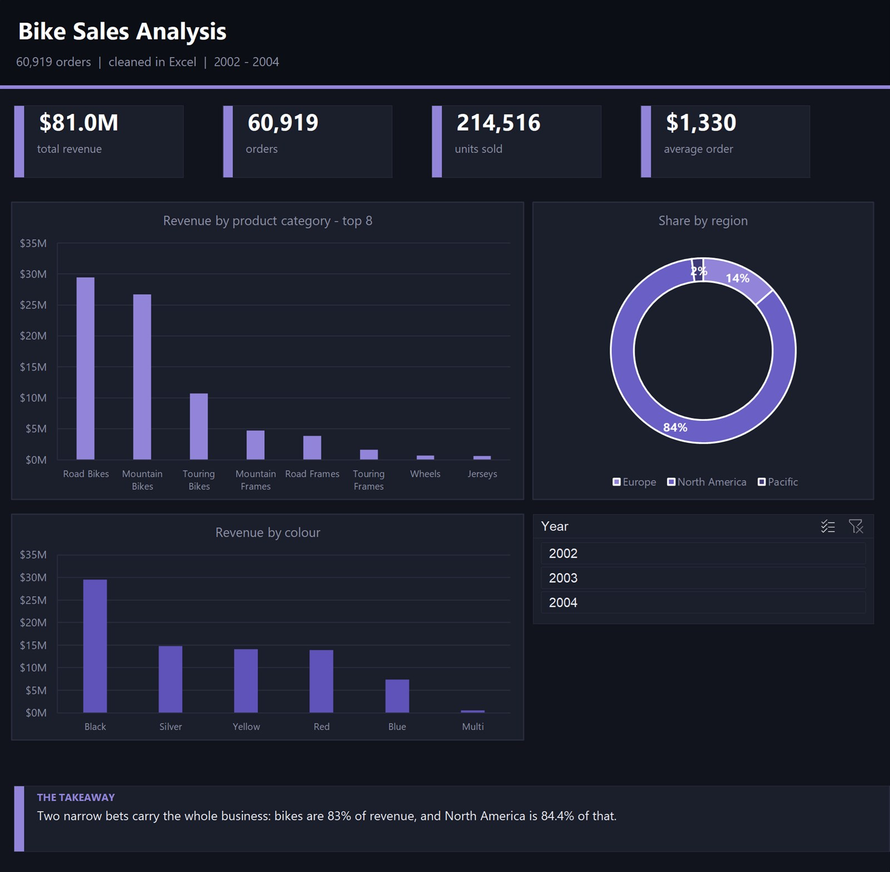
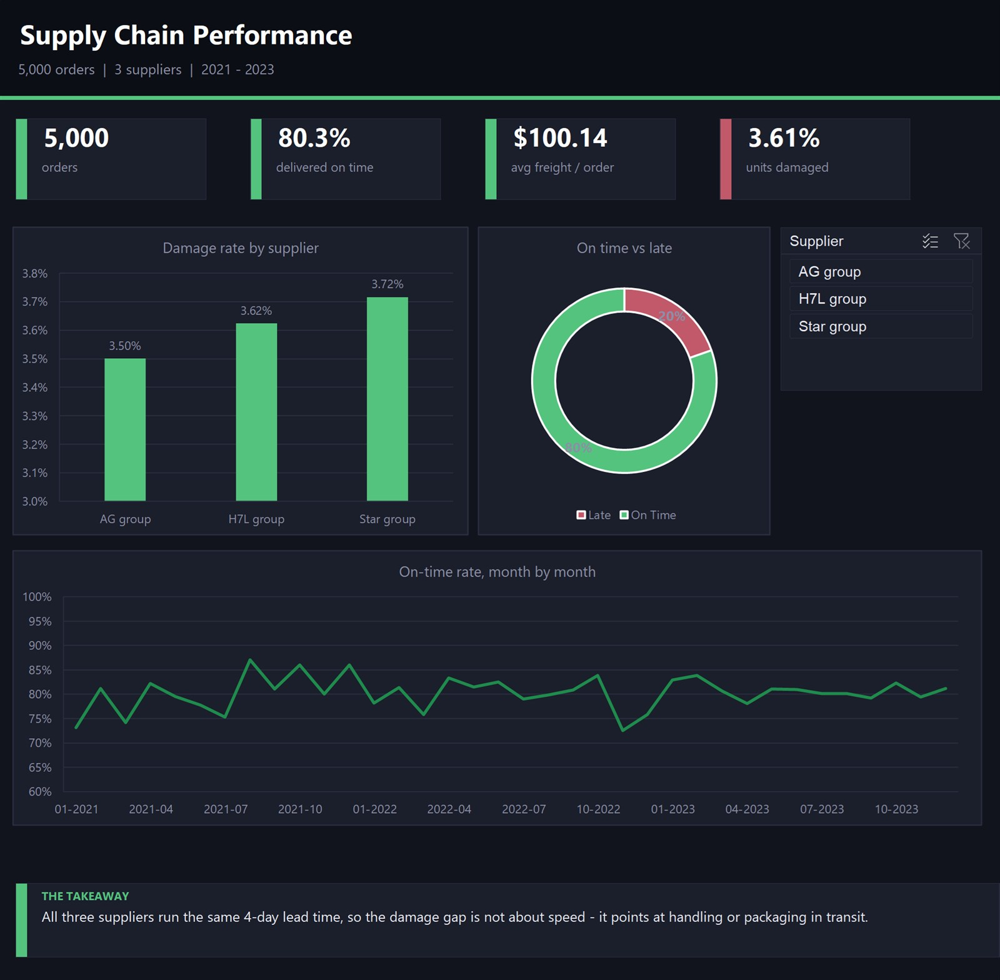
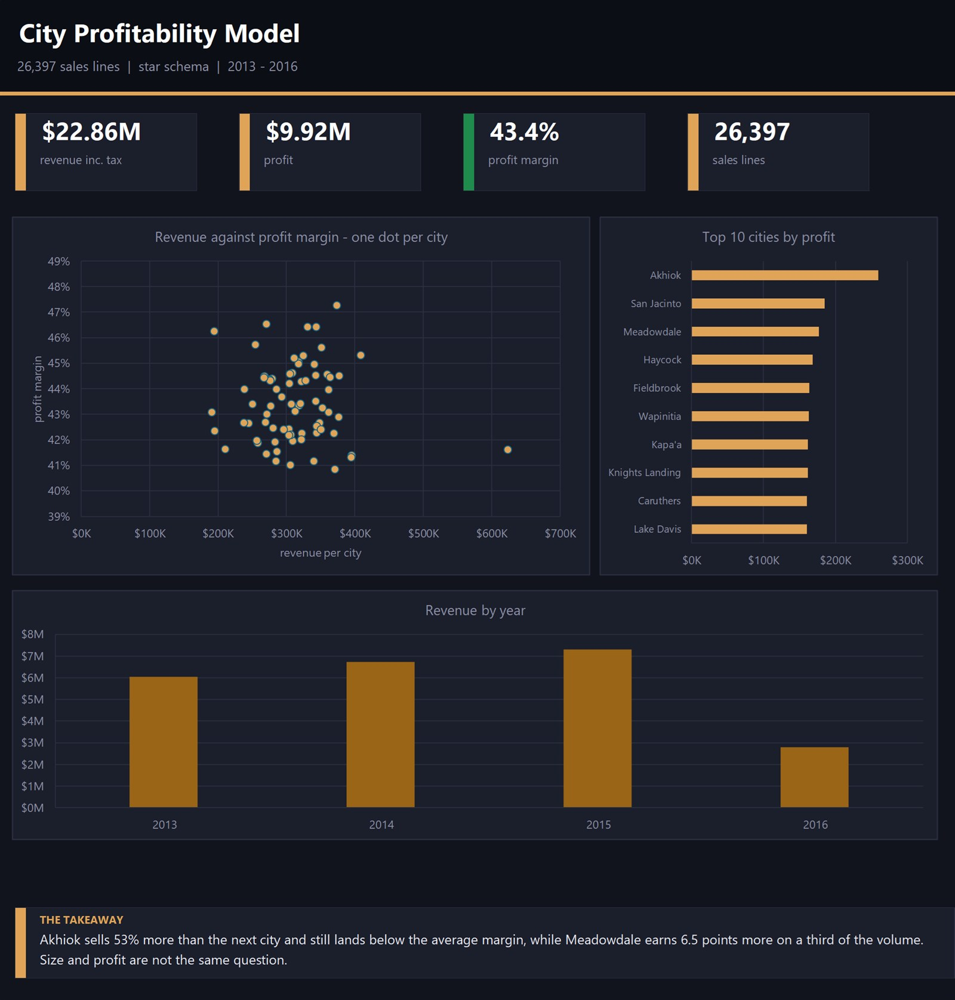
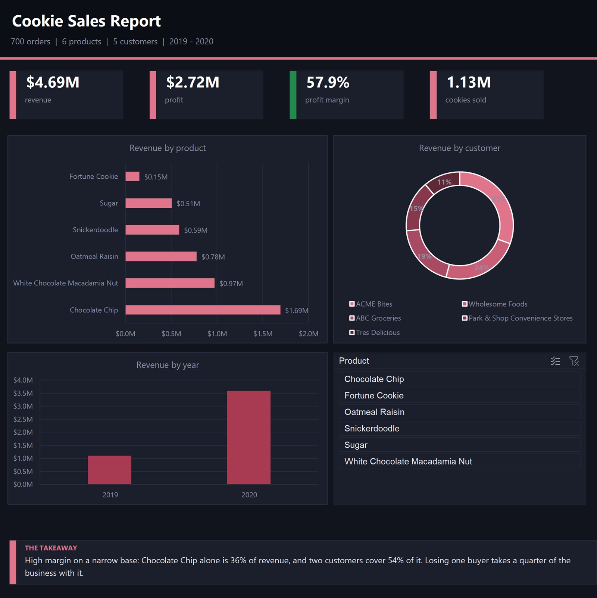

<div align="center">

# Data Analysis Projects

**Business questions, reproducible analysis, and decision-focused reporting.**

SQL · Excel · Power BI · Data Modelling

</div>

This repository brings together four focused analysis projects. Each project keeps its original data, queries, dashboard files, preview, and development history inside a dedicated folder.

## Project gallery

<table>
  <tr>
    <td width="50%" valign="top">
      <a href="./bike-sales-analysis/"></a>
      <h3>Bike Sales Analysis</h3>
      <p>Examines 60,919 order records to identify where revenue is concentrated across products and regions.</p>
      <p><strong>Dataset:</strong> Cleaned sales workbook included in the project.<br><strong>Tools:</strong> Excel, Power Query, SQL<br><strong>Question:</strong> Where does the business actually make its money?</p>
      <p><a href="./bike-sales-analysis/"><strong>Open project →</strong></a></p>
    </td>
    <td width="50%" valign="top">
      <a href="./supply-chain-performance/"></a>
      <h3>Supply Chain Performance</h3>
      <p>Connects orders, delivery status, and supplier data to investigate delays, freight cost, damage, and returns.</p>
      <p><strong>Dataset:</strong> Three source CSV files included in the project.<br><strong>Tools:</strong> SQL, SQLite, Excel<br><strong>Question:</strong> Are operational losses driven by one supplier or a shared process?</p>
      <p><a href="./supply-chain-performance/"><strong>Open project →</strong></a></p>
    </td>
  </tr>
  <tr>
    <td width="50%" valign="top">
      <a href="./city-profitability-analysis/"></a>
      <h3>City Profitability Analysis</h3>
      <p>Uses a fact table and five dimensions to compare city-level revenue, profit, and margin.</p>
      <p><strong>Dataset:</strong> Wide World Importers fact and dimension files included.<br><strong>Tools:</strong> SQL, SQLite, dimensional modelling<br><strong>Question:</strong> Is the highest-selling city also the most profitable?</p>
      <p><a href="./city-profitability-analysis/"><strong>Open project →</strong></a></p>
    </td>
    <td width="50%" valign="top">
      <a href="./cookie-sales-analysis/"></a>
      <h3>Cookie Sales Analysis</h3>
      <p>Models orders, products, and customers to expose product and customer concentration in a wholesale bakery.</p>
      <p><strong>Dataset:</strong> Orders, product, and customer files included.<br><strong>Tools:</strong> Power BI, DAX, Excel, SQL<br><strong>Question:</strong> How dependent is the business on a small number of products and buyers?</p>
      <p><a href="./cookie-sales-analysis/"><strong>Open project →</strong></a></p>
    </td>
  </tr>
</table>

## Repository structure

```text
data-analysis-projects/
├── bike-sales-analysis/
├── supply-chain-performance/
├── city-profitability-analysis/
├── cookie-sales-analysis/
└── README.md
```

Every folder is self-contained. Future large projects that warrant their own product narrative will remain in standalone repositories.

