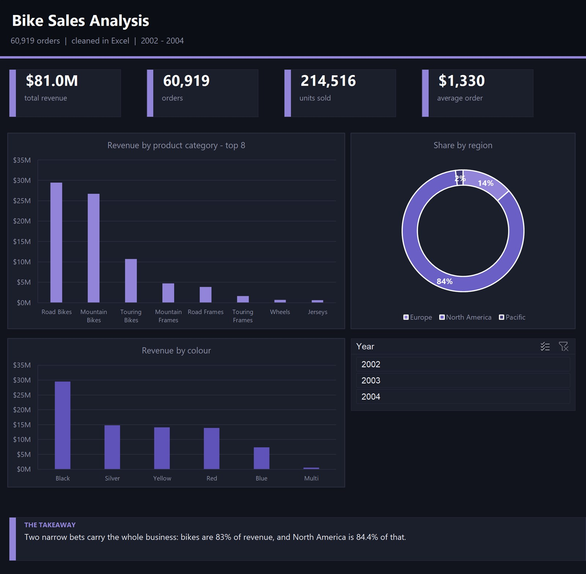

# Bike Sales Analysis



A bike retailer's order history — 60,919 rows — cleaned up and turned into a
dashboard that answers one question: where does the money actually come from?

## What I found

| | |
|---|---|
| Revenue | $81.0M |
| Orders | 60,919 |
| Units sold | 214,516 |
| Average order | $1,330 |

Bikes bring in 83% of the revenue, and North America brings in 84.4% of that.
So the business is really two bets, not a diversified catalogue. Accessories and
clothing look busy in the order count but barely register in revenue.

If I were handing this to an owner, that concentration is the first slide, not
the growth number.

## What I did

Started in Excel. The raw export had a row where the Region column said "Total"
and the Year column said 122021530 — a summary line that had been pasted into
the data. Left in, it inflates every total. I removed it and re-checked the
column types before doing anything else.

From there: pivot tables by category, region, model and colour, then a dashboard
on top of them.

## The queries

`queries.sql` has every query behind the numbers above, with a note on each
one explaining what it answers. Load the `Sales Data` sheet as a table named
`sales` in any SQL tool and they run as-is.

## Files

```
data/sales-dashboard.xlsx   the cleaned workbook with the dashboard
queries.sql                 the SQL behind every number here
```

## Tools

Excel (pivot tables, Power Query), SQL

---
Rakan Ahmed Al-Nusayri — [github.com/RaKaN-DaTa](https://github.com/RaKaN-DaTa)
