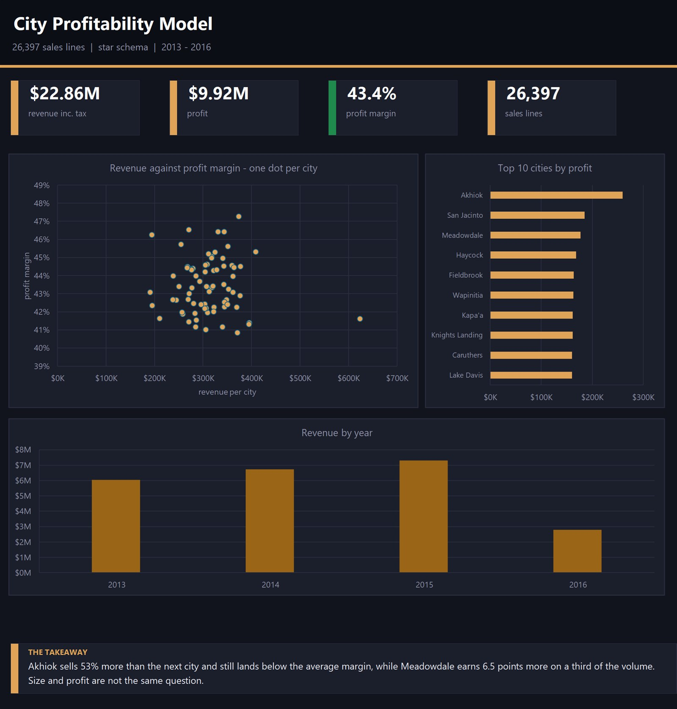

# City Profitability Model



A sales dataset modelled properly — one fact table, five dimensions — so I could
test a claim that sounds obvious and turns out not to be: that the city selling
the most is the city worth the most.

## What I found

| | |
|---|---|
| Sales lines | 26,397 |
| Revenue (inc. tax) | $22.86M |
| Profit | $9.92M |
| Overall margin | 43.4% |
| Units | 1,028,670 |

Akhiok is the biggest city by a distance — $624K in revenue, 53% ahead of the
next one. Its margin is 41.6%, below the company average.

Meadowdale sells a third of that and earns 47.3%. Across the 73 cities above
$150K, the gap between best and worst margin is 6.5 points, and it has no
relationship to size — plot revenue against margin and the dots sit flat.

So "our biggest city" and "our best city" are two different lists. If sales
effort follows revenue alone, it follows the wrong one.

## The model

```
FactSale (26,397 rows)
   |- DimCity        city, state, country, territory
   |- DimCustomer
   |- DimDate
   |- DimStockItem
   |- DimEmployee
```

A star schema: measurements in the middle, descriptions around it. It keeps the
joins shallow and means a question like "profit by territory by month" is one
query instead of a chain of them.

## The queries

`queries.sql` walks through it: the totals, the top cities by profit, then the
same list sorted by margin so the mismatch is visible. Each query has a note
explaining what it answers. Load the CSVs as `sales`, `cities`, `items` and
`dates` in any SQL tool and they run as-is.

Two of the dimension files (`DimCustomer`, `DimStockItem`) have a report title
sitting above the real header row — a normal artefact of exports from company
systems. That row has to come off before the file loads correctly.

## Files

```
data/FactSale.csv                     the fact table
data/Dim*.csv                         the five dimension tables
queries.sql                           the SQL behind every number here
city-profitability-dashboard.xlsx     an interactive Excel dashboard over the same data
```

## Tools

SQL, SQLite, dimensional modelling

---
Rakan Ahmed Al-Nusayri — [github.com/RaKaN-DaTa](https://github.com/RaKaN-DaTa)
