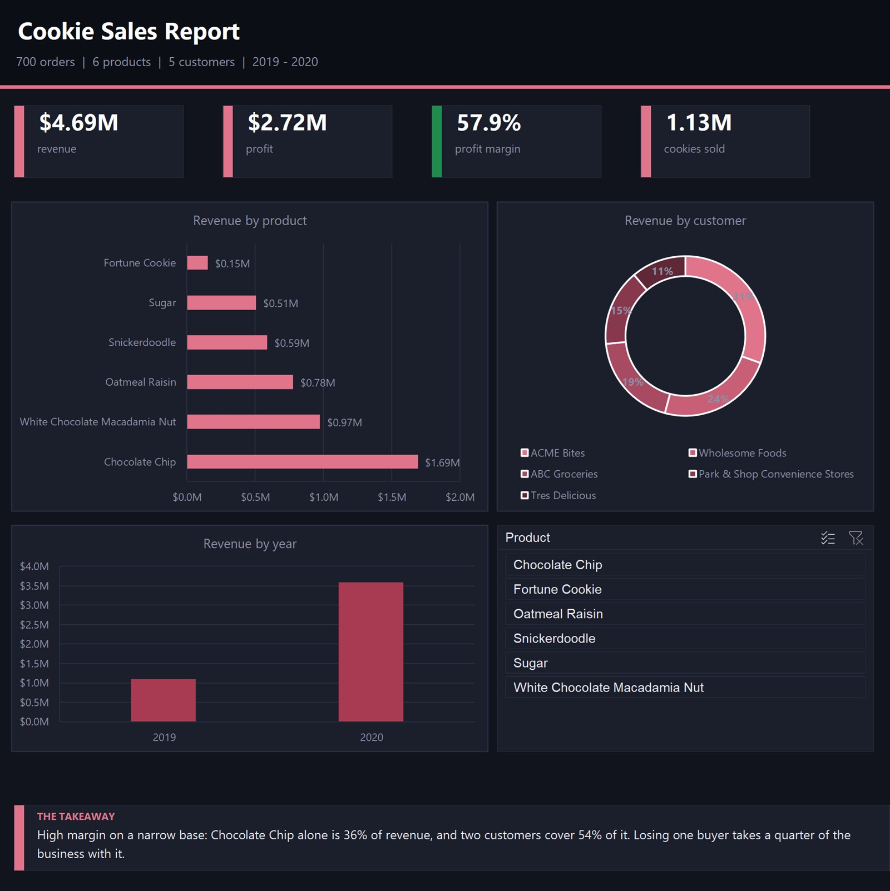

# Cookie Sales Report



A Power BI report built on three tables — orders, products, customers — for a
bakery selling wholesale. Small dataset, but it makes a point about who a
business actually depends on.

## What I found

| | |
|---|---|
| Revenue | $4.69M |
| Profit | $2.72M |
| Margin | 57.9% |
| Cookies sold | 1,125,788 |
| Orders | 700 |

Chocolate Chip alone is 36% of revenue. Add White Chocolate Macadamia and you're
at 57% from two products out of six. Fortune Cookie is 3% and priced at $1
against $5 for the others, so it moves volume without moving money.

The customer side is tighter still. ACME Bites is 31% of revenue and Wholesome
Foods is 24% — 54% of the business sits with two buyers out of five.

High margins on a concentrated base look healthy right up until one buyer
leaves. That's the finding worth reporting, not the growth between 2019 and 2020.

## The model

Orders is the fact table. It joins to Cookie Types on product name (which
carries the price and cost per cookie, so revenue and profit are measures, not
stored columns) and to Customers on customer ID. Dates come in as Excel serial
numbers and need converting before any time analysis works.

## Files

```
cookie-sales-report.pbix      the Power BI report
cookie-sales-dashboard.xlsx   the same analysis as an Excel dashboard
data/Orders.xlsx           700 orders
data/Cookie Types.xlsx     price and cost per product
data/Customers.csv         the five customers
queries.sql                the same numbers in SQL
```

Open the `.pbix` in Power BI Desktop (free) to see the report and the model.

`queries.sql` has the same calculations written in SQL, with a note on each
one — useful for checking the report's numbers against the raw files.

## Tools

Power BI, DAX, data modelling, Excel

---
Rakan Ahmed Al-Nusayri — [github.com/RaKaN-DaTa](https://github.com/RaKaN-DaTa)
